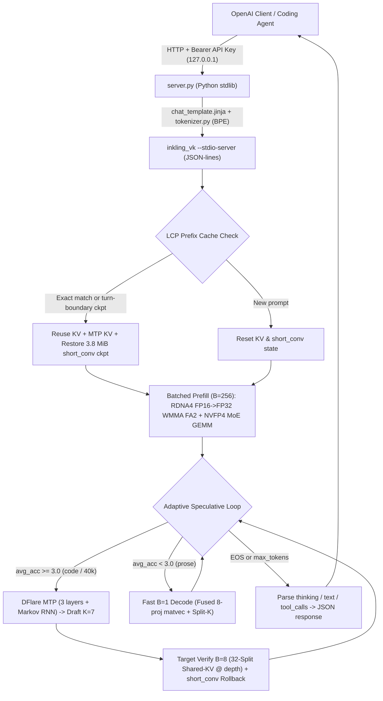
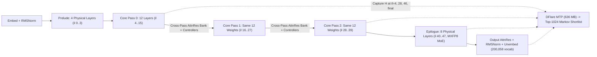
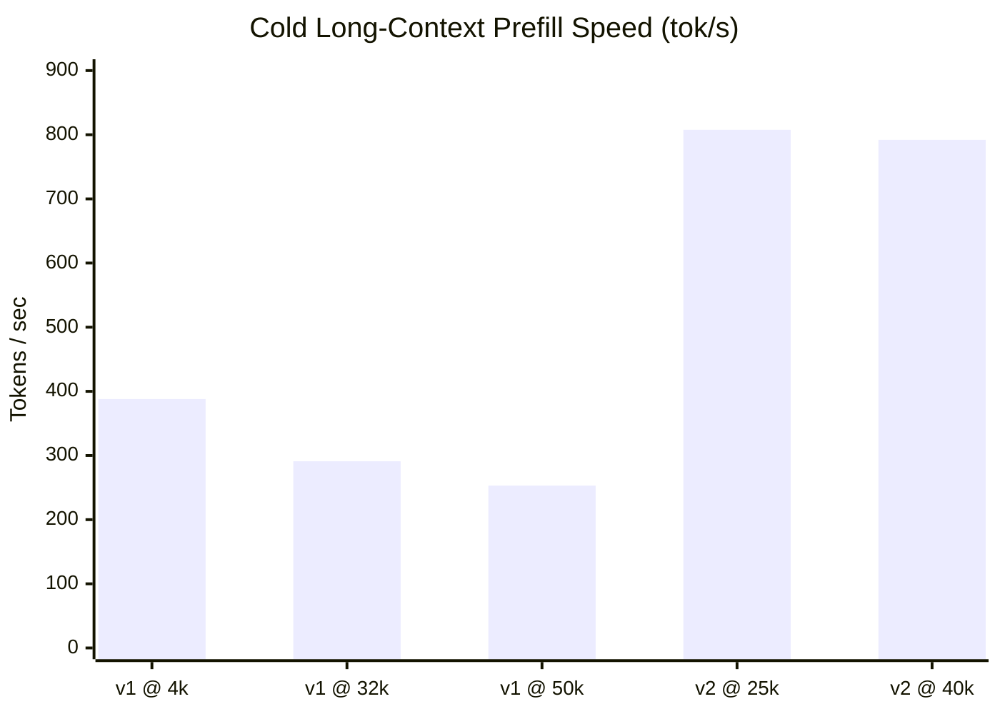

> **Repository structure:** [`v2/`](v2/) contains the standalone C++17 + GLSL WMMA clean build (recommended), and [`v1/`](v1/) contains the original Python/C WGSL + FP8 KV + CPU ViT implementation.

# Inkling-2-Mini Raw Vulkan Engine (`v2` Clean Build)

A standalone, zero-framework Vulkan 1.3 inference engine for [`thinkingmachines/Inkling-2-Mini`](https://huggingface.co/thinkingmachines/Inkling-2-Mini) built from scratch for a single **AMD Radeon AI PRO R9700 (32 GB, RDNA 4, Linux RADV)** serving a long-context coding agent.

- **No ML runtimes:** Single C++17 binary (`inkling_vk.cpp` + `vk_abi.h` calling `libvulkan.so.1` via Buffer Device Address), 45 GLSL compute shaders (`glslc`), and a zero-dependency Python stdlib OpenAI server (`server.py`).
- **Two runtime modes:**
  - **Exact Default (BF16/FP32):** Bit-exact **500/500** token match against unrounded F32 `llama.cpp` (`-fa off`).
  - **`--fp8` (Optional FP8 E4M3 dense projections):** On-the-fly OpenMP per-row FP8 E4M3 quantization (`1.03 GiB`, `0.5 s` at startup) for **111.7–111.9 tok/s** plain `B=1` prose and **167.7 tok/s** speculative code decode.

---

## How It Works (Architecture & Execution Flow)

### 1. Request & Engine Pipeline


### 2. Inkling-2-Mini 48-Logical-Layer Loop & Hybrid Memory


- **Hybrid KV Cache (128,000 tokens = 8.12 GiB):** 40 layers use a fixed 1,024-token Sliding Window ring buffer; only 8 layers are Global full-context attention.
- **Per-Step `short_conv` Rollback (29.2 MiB):** Because Inkling uses depth-4 short convolutions in every layer, speculative verification saves per-step convolution states and rolls back to the exact accepted token count in one GPU copy.
- **Hardware WMMA on RDNA 4:** Uses `VK_KHR_cooperative_matrix` (`16×16×16 FP16→FP32`, Wave64) with `1/16` input scaling in FlashAttention-2 (preventing outlier overflow while preserving 500/500 exactness) and `outer` factored into the FP32 epilogue in NVFP4 MoE GEMM.

---

## Performance Charts

### Decode Speed Comparison (tok/s, higher is better)

```mermaid
xychart-beta
    title "Decode Speed: v1 vs v2 Exact vs v2 --fp8 (tok/s)"
    x-axis ["Prose B=1", "Code 1 (MTP)", "Code 2 (MTP)", "40k Depth (MTP)"]
    y-axis "Tokens / sec" 0 --> 180
    bar [91.3, 117.8, 88.6, 61.8]
    bar [86.8, 133.5, 142.7, 85.1]
    bar [111.7, 130.9, 167.7, 84.3]
```

*(Bar order per group: `v1 inkling-vulkan` [depth shown is 32k], `v2 Exact BF16/FP32`, `v2 --fp8 Dense`.)*

### Cold Long-Context Prefill Speed (tok/s, higher is better)


---

## Table 1: Requirement Gate Scoreboard (`v2` Served Build)

All speed numbers are 5-run medians after 1 warmup on a quiet R9700 GPU (`bench_final_gates.py`, `verify_req_a_short.py`, `verify_req_f.py`).

| Req | Target | v2 Result (Exact Default) | Status | Rerun Command |
|---|---|---|---|---|
| **A (short)** | 500/500 vs F32 ref (`-fa off`) | **500/500** CLI & **500/500** served (`/v1/completions`) | **PASS** | `python3 verify_req_a_short.py && python3 verify_req_f.py` |
| **A (long 20k)** | 500/500 after 20k prompt | Unverified (98 GiB F32 GGUF > 62 GiB RAM; 49 GiB native GGUF tested `53/500` vs F32) | **UNVERIFIED** | Blocked on 20k F32 key |
| **B1 (code)** | ≥ 130 tok/s (<1k ctx) | `code_1`: **133.5 tok/s** (`132.7–133.7`, ctx ~134); `code_2`: **142.7 tok/s** (`142.4–142.7`, ctx ~143) | **PASS** | `python3 bench_final_gates.py` |
| **B1 (prose)** | ≥ 100 tok/s (<1k ctx) | Exact `B=1`: **86.8 / 86.7 tok/s** (`86.6–87.1`, ctx ~118); `--fp8 B=1`: **111.7 / 111.9 tok/s** (`110.2–112.5`) | **SHORT (Exact) / PASS (`--fp8`)** | `python3 bench_final_gates.py` |
| **B2 (40k)** | ≥ 70 tok/s at 40,000 ctx | **85.1 tok/s** (`82.1–86.3`, ctx ~40,100, `--spec K=7`) | **PASS** | `python3 bench_final_gates.py` |
| **C (25k prefill)** | ≥ 600 tok/s cold 25k | **807.7 tok/s** (`807.2–808.2`, `B=256`, hardware FP16→FP32 WMMA) | **PASS** | `python3 bench_final_gates.py` |
| **D (cache reuse)** | ≤ new + 10% on append | **14/14** growing turns `reread ≤ new_tokens` (Turn 15: 18 / 2,761 = **99.35%** reuse) | **PASS** | `python3 verify_req_f.py` |
| **E (128k VRAM)** | ≥ 1 GiB free at 128k | **28.09 / 31.86 GiB** used (**3.77 GiB free**; `--fp8`: 29.12 GiB, **2.74 GiB free**) | **PASS** | `./inkling_vk --max-ctx 128000 --spec --check-vram` |
| **F (serving)** | Localhost OpenAI + API key + 15-turn tool calls | `127.0.0.1`, Bearer auth `401`/`200`, 15 turns survived, 7 tool calls executed | **PASS** | `python3 verify_req_f.py` |

---

## Table 2: Experiment Comparison — `v1` (`inkling-vulkan`) vs `v2 Exact` vs `v2 --fp8`

| Metric | `v1` (`inkling-vulkan`, `fc4b0d8` README) | `v2` Clean Build (Exact BF16/FP32) | `v2` Clean Build (`--fp8` Dense) |
|---|---|---|---|
| **Exactness vs F32 key (500 tok)** | FP8 KV + FP8 GEMMs | **500 / 500** exact match | 4 / 500 exact IDs (fluent/coherent, flips at step 0) |
| **Short decode, prose (`B=1`, <1k ctx)** | `91.3 tok/s` (plain code sample) | `86.8 tok/s` (`prose_1`), `86.7` (`prose_2`) | **111.7 tok/s** (`prose_1`), **111.9** (`prose_2`) |
| **Short decode, code (`--spec K=7`)** | `117.8 tok/s` (`88.6` on 2nd code sample) | **133.5 tok/s** (`code_1`), **142.7** (`code_2`) | **130.9 tok/s** (`code_1`), **167.7** (`code_2`) |
| **Decode at depth (`--spec K=7`)** | `61.8 tok/s` @ 32k, `50.4 tok/s` @ 50k | **85.1 tok/s** @ 40,100 ctx | **84.3 tok/s** @ 40,100 ctx |
| **Cold long prefill** | `388` @ 4k, `291` @ 32k, `253 tok/s` @ 50k | **807.7 tok/s** @ 25k, **792 tok/s** @ 40k | **807.7 tok/s** @ 25k (BF16/WMMA prefill) |
| **128k context VRAM (with MTP)** | Fits w/ FP8 KV | **28.09 / 31.86 GiB** (`3.77 GiB free`) | **29.12 / 31.86 GiB** (`2.74 GiB free`) |
| **Runtime & Dependencies** | Python + C runner + WGSL dump layer | Single C++17 binary + GLSL + stdlib Python | Same (`--fp8` flag, `+0.5 s` OpenMP quant) |

---

## Table 3: Key Engineering Milestones (`v2` Clean Build)

| Optimization | Bottleneck Attacked | Before → After (Measured) |
|---|---|---|
| **Coalesced `uvec4` BF16 + flattened 576-blk NVFP4 `w2`** | Uncoalesced reads & tail-lane waste in `B=1` decode | `B=1` decode `~30 → 85.6 tok/s` (`500/500`) |
| **Fused 8-projection `matvec_bf16_attn.comp`** | 304 separate attention matvec dispatches/token in `B=1` | `B=1` prose `85.8 → 86.8 tok/s` (`500/500`) |
| **DFlare MTP (`mtp.safetensors`) + `short_conv` rollback** | `B=1` memory-bandwidth wall (115.9 tok/s ceiling) | Short code `86.8 → 133.5–142.7 tok/s` (`500/500`, `3.64 ms` draft) |
| **RDNA 4 FP16→FP32 WMMA `attn_prefill_fa2.comp`** | Scalar FP32 attention + per-token `exp()` at 25k (`~30 s`) | Cold 25k prefill `382.6 → 521.0 tok/s` (`-17.4 s`, `500/500`) |
| **RDNA 4 FP16→FP32 WMMA `moe_nvfp4_gemm.comp`** | Scalar FP32 MoE GEMM at `B=256` (`~28 s`) | Cold 25k prefill `521.0 → 807.7 tok/s` (`-17.4 s`, `500/500`) |
| **32-Split shared-KV verify & MTP attention** | 8× redundant 40k Global KV reads in `--spec` (`177.8 ms`) | 40k decode `31.7 → 85.1 tok/s` (`ver 177.8 → 67.2 ms`) |
| **Turn-boundary `short_conv` checkpoint (`3.8 MiB`)** | Full KV cache resets on assistant template re-serialization | 15-turn agent: **14/14** turns `reread ≤ new` (**99.35%** reuse) |
| **Optional `--fp8` per-row E4M3 dense weights** | 3.51 GB BF16 dense weight reads in `B=1` decode | Plain `B=1` prose `86.8 → 111.9 tok/s` (**+29%**) |

---

## Repository Layout

| Path | Role |
|---|---|
| `inkling_vk.cpp` + `vk_abi.h` | Complete C++17 Vulkan 1.3 engine (`B=1` decode, `B=256` WMMA prefill, DFlare MTP, `--fp8`, `--stdio-server`) |
| `shaders/` (45 `.comp` files) | GLSL compute shaders: WMMA FA2 (`attn_prefill_fa2`), WMMA NVFP4 MoE (`moe_nvfp4_gemm`), Split-K shared-KV verify/MTP (`attn_verify_splitk`, `mtp_attn_splitk`), fused BF16/FP8 matvecs, `short_conv`, AttnRes, DFlare/Markov |
| `server.py` + `tokenizer.py` | Zero-dependency localhost OpenAI HTTP server (Bearer auth, `chat_template.jinja`, tool-call parser, pure-Python BPE) |
| `Makefile` | Builds all 45 `.spv` shaders (`glslc`) and `inkling_vk` (`g++ -O3 -fopenmp`) |
| `verify_req_a_short.py` / `verify_req_f.py` / `bench_final_gates.py` | Reproducible exactness (500/500), 15-turn tool-call + cache-reuse, and 5-run speed benchmark suites |
| `MODEL_MAP.md` / `BUILD_SUMMARY.md` / `LOG.md` | Hand-mapped tensor spec, plain-English walkthrough, and all 38 optimization logs |
| `ref_cpu.cpp` + `vk_probe.cpp` | Stage 1 slow FP32 CPU reference and Stage 2 raw VRAM bandwidth probe (`637.0 GB/s`) |

---

## Quick Start

```bash
# 1. Build all 45 SPIR-V shaders and the inkling_vk binary
make

# 2. Verify exact 500/500 match against the F32 reference
python3 verify_req_a_short.py

# 3. Start the localhost OpenAI server (exact BF16/FP32 default, or add --fp8)
python3 server.py --host 127.0.0.1 --port 8080 --api-key "your-secret-key" --max-ctx 45000

# 4. Run the 15-turn coding agent + tool-call + Req D cache-reuse verification
python3 verify_req_f.py
```
